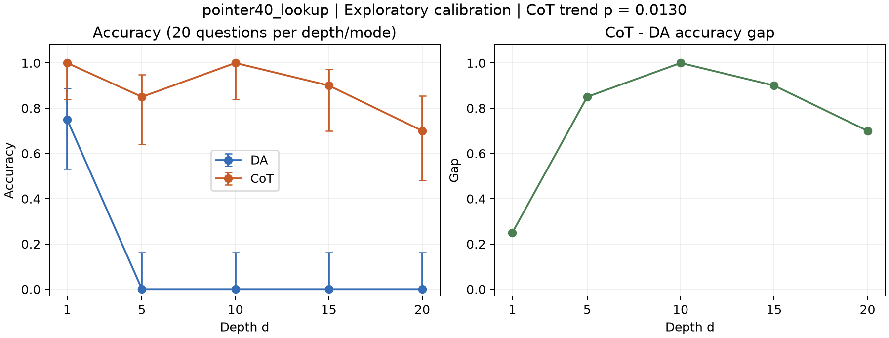

# Task A 查表指针定题审查（2026-11-09）

用户于 2026-11-09 回复“接受”，批准 `pointer40_lookup` 及本报告列明的局限。**正式 3000 题已生成并验证，Task A 按人工接受的例外完成。**
唯一硬门槛 CoT(20) 已通过，但不能称所有目标通过，或已证实纯查表能力随深度下降。
本次不为追求 p<0.01 而反复加样本或改检验方向。若人工不接受以下限制，应另立方案并重新校准。

## 数据与复核

用户执行 notebook 提交 `4e65653`，原始 ZIP 已按要求先单独提交并推送 `ae03c89`，之后才开展分析。
上传 JSONL 为 400 条（指针探针 200 + 新增斜率 200）；合并历史寄存器后 canonical 为 600 条，诊断另有 64 条。
上传文件逐字节保存在 [归档目录](archives/lookup_slope_20261109/)，所有历史行保留，无相同 id 冲突。
200 条斜率的题目重建、独立 gold、prompt/模型/采样指纹、重判分、输入 token 记录哈希/长度与摘要全部一致。
无解析失败或截断，模型输出 6–1433 tokens，远低于 6144 上限。输入核对基于运行时记录哈希，不冒称重新离线分词。
模型 `Qwen/Qwen3-4B-Instruct-2507`，commit `cdbee75f17c01a7cc42f958dc650907174af0554`；T4 参数保持不变。

## 结果

每格 20 题，DA/CoT 使用同题配对。100 条独立探针为 87/100，Wilson 95% CI [0.7902, 0.9224]。

| d | DA 正确/20 | CoT 正确/20 | gap |
|---|---:|---:|---:|
| 1 | 15 | 20 | 0.25 |
| 5 | 0 | 17 | 0.85 |
| 10 | 0 | 20 | 1.00 |
| 15 | 0 | 18 | 0.90 |
| 20 | 0 | 14 | 0.70 |

| 验收指标 | 实测 | 判定 |
|---|---|---|
| CoT(20) 0.40–0.75（唯一硬门槛） | 0.70；Wilson 95% CI [0.4810, 0.8545] | 点估计通过；区间较宽 |
| DA(20) ≤0.10 | 0/20 | 点估计通过；95% 上界 0.1611 |
| gap(20)−gap(1) ≥0.30 | 0.45；配对 bootstrap 95% CI [0.15,0.70] | 点估计通过；区间未完全超过 0.30 |
| CoT 下降趋势 CA p<0.01 | z=−2.4838；双侧 p=0.0130003 | **未达标** |
| DA(1) 0.80–0.95 | 探针 0.87；独立斜率 d1 0.75 | 探针符合；独立小样本有波动 |
| 启发式探针窗口 0.955–0.986 | 0.87 | 未达标，已预先记录斜率例外 |

CoT 序列 1.00→0.85→1.00→0.90→0.70，gap 序列 0.25→0.85→1.00→0.90→0.70，均非单调。
CA 检验对象是 CoT 准确率，不是 gap；不将 p=0.013 改报为达到 0.01，也不事后改成单侧检验。
DA 从 d=5 即地板，后续 gap 的变化主要由 CoT 决定；不能宣称 gap 全程随 d 增长。

## 全部 CoT 错误原文审查

逐条读完 11 条错误：9 条正确查表后**多走一步**，2 条正确查表后**少走一步**。
在这 11 条错误中未观察到错误的表转移，最终答案错误不能后处理改为正确。此审查是助手分析，不替代人工批准。
每条原文可按下表 id/qid 在 [原始 JSONL](archives/lookup_slope_20261109/calib_v3_task.jsonl) 查找；完整 id 见 [机器审查报告](task_a_lookup_review.json)。

| d | 题号 i | gold | 输出 | 原文所示执行步数 | qid 前缀 |
|---|---:|---:|---:|---:|---|
| 5 | 12 | 29 | 17 | 6 | 0f68c65806bc |
| 5 | 16 | 9 | 39 | 6 | 4c61606f275d |
| 5 | 19 | 3 | 25 | 6 | 43bf9683d667 |
| 15 | 3 | 17 | 9 | 14 | 531de4f6f4e8 |
| 15 | 15 | 14 | 0 | 14 | 48d402c4a80d |
| 20 | 1 | 38 | 27 | 21 | 40a2ac17903a |
| 20 | 9 | 3 | 24 | 21 | 942b24fef1c8 |
| 20 | 14 | 20 | 39 | 21 | c20ed41a671b |
| 20 | 16 | 10 | 38 | 21 | f91d7efa94ef |
| 20 | 17 | 18 | 34 | 21 | 76f714fe1f7e |
| 20 | 18 | 5 | 20 | 21 | 77ca48803d4e |

这项任务测量的是表依赖追踪加步数控制。当前离开天花板可能由停止步数错误主导，提示词若增加计步支架可能改变难度；
本轮保持原提示不动，避免在看过结果后调整任务再引用旧校准。接受时必须保留这一解释范围，不把它包装为纯算子难度。

## 已批准并执行的正式生成方案

- 固定 `pointer_numeric_v1`、`pointer40_lookup`、seed=7404，不更换题目规则或提示。
- 串行 d=1..20，每格 100 题，共 2000 条。
- 并行 w=1..10，每格 100 题，共 1000 条；链长 `[1,2,...,2]`，W=2w−1，实际最长链为 1 或 2。
- 固定 40 行共享只读表，各并行路径节点不重叠；W_atomic=W。串行奇数 d=1..19 与并行配平。
- 并行读出 w 个答案，有额外读出成本；不能将其作为无混杂的纯深度因果实验。
- 正式 split 与 probe/slope 分开；生成前审核结果指纹，生成后查重、独立求解和 datasets 回读。
- 产物 `Experiments/data_generation/synthesis_pointer_numeric_dataset.jsonl`（3000 条）与 `.manifest.json`，记录审核及未达指标。
- 这一步仅生成可用于后续实验的题集，不运行正式模型全矩阵，也不开始 Task B。

人工已接受：p=0.013 的辅助指标偏离、非单调曲线、较宽区间、步数控制主导错误和并行读出成本。
批准应绑定 evidence_digest：`2faa1a59276e6bc913f96271c9a7060434d740728eb15fae4bcdb24dc62f7703`。
人工记录见 [task_a_human_review.json](task_a_human_review.json)。已在 CPU 完成正式生成与完整性检查，见 [验证报告](task_a_final_validation.json)。
notebook 默认 GENERATE_FINAL=False 仅避免重复写文件，不表示审核未通过；需要复现时开启即可，审核仍绑定上述指纹。

正式数据 SHA256：`6b76b73f6ba3b523cbc8c59de8f5fc904deccd0e1b316e16364325820a9382ed`。600 条历史校准原文及 64 条诊断未改变。
